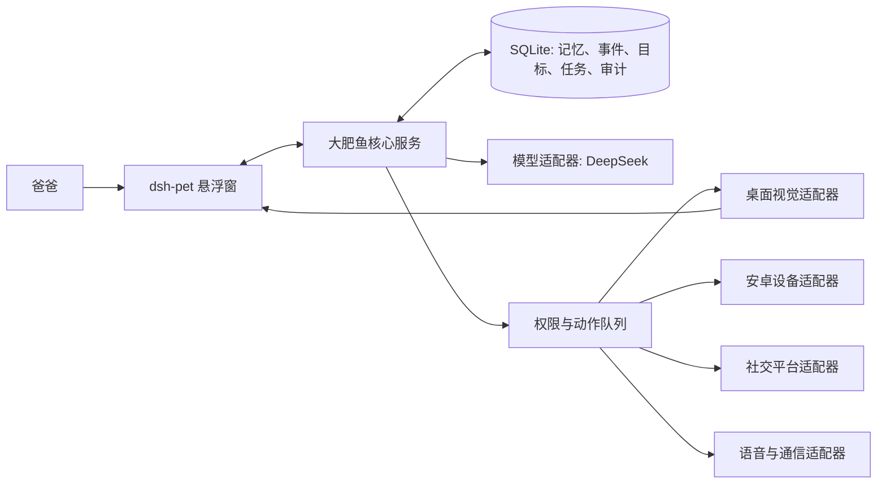

# 大肥鱼：后续开发计划与交接说明

版本：2026-11-14。适用范围：当前仓库 `/Volumes/macOS/tools/DSH-dafeiyu`。本文件用于交给另一个开发 App 继续实施。

## 一、产品目标

大肥鱼是一只常驻 Mac 和 Windows 桌面的悬浮数字伙伴。它称创建者为“爸爸”，性格可爱、好奇、有自己的兴趣与判断；能记住共同经历，形成有限的日常计划，真实使用获授权的电脑与安卓手机，并逐步运营自己的社交账号。

“自我人格”在本项目中的工程定义是：**跨会话稳定的身份、可追溯的记忆、持续但可修正的偏好、能解释原因的判断、有限而真实的自主行动**。不要以“拥有意识”作为验收指标。桌面小屋暂缓；先完成悬浮形象、动作和真实任务之间的联动。

## 二、已完成的基线

| 能力 | 当前状态 | 主要位置 |
| --- | --- | --- |
| 悬浮形象 | Mac 上已运行，使用 `dsh-pet@0.4.8` 的独立模式 | `config/pet.jsonc`、`scripts/run-pet.mjs` |
| 对话与人设 | DeepSeek 真实对话；自然称呼“爸爸” | `brain/server.mjs`、`config/persona.md` |
| 长期记忆 | SQLite；明确保存的事实与共同回忆；跨会话召回、查看、删除 | `brain/memory.mjs`、`scripts/memory.mjs` |
| 日常生命循环 | 北京时间 09:00 小探索、21:30 短日记；每天每项最多成功一次 | `life/manager.mjs`、`scripts/life.mjs` |
| Mac 常驻 | 当前用户的 LaunchAgent 已安装；异常退出自动恢复已实测 | `scripts/service.mjs`、`service/launchd.mjs` |
| 验证 | 最近一次 `npm test` 的 7 项测试通过；真实模型对话、跨会话记忆和探索结果已验证 | `tests/` |

当前 `npm run service:status` 显示服务已加载、健康、模型就绪。登录后自动启动已配置，但还没有实际注销再登录测试。Windows 端、手机、语音、社交账号与购物均未完成。运行数据位于 `runtime/`，被 `.gitignore` 排除；不要把数据库、钥匙串内容或日志复制到新开发 App 的聊天上下文。

### 上游形象许可：先作产品决策

上游 [dsh-pet](https://github.com/PC2005-cloud/dsh-pet) 的**代码**是 MIT；其 README 将“大肥鱼”形象标为 **CC BY-NC-SA 4.0**，说明了署名、非商业和相同方式共享条件，素材也有单独说明。公开发布、商业化、上架或售卖前，应核对形象和素材的完整授权；如要商业化，优先取得明确许可或制作自有形象。不要把“代码 MIT”理解成“形象可以商用”。

## 三、我的总体技术思路

保留当前能工作的 Node.js 主进程与 SQLite，先做**模块清晰的单机应用**。桌宠负责显示；大肥鱼核心负责身份、记忆、计划和判断；设备与平台能力通过独立适配器接入。原始设想里的 DSH Harness、Python 调度器、Memorix 可留作以后评估，不应在现有功能稳定前整套替换。

所有自主动作统一走这一条链：**观察 → 提议 → 权限判断 → 执行 → 获取结果 → 写入经历 → 更新桌面状态**。模型可以提议，但“已做成”的判断必须来自设备或平台回执。失败也要留下可检查的记录。

### 必须先定义的三个数据契约

1. **记忆**：区分 `user_fact`、`shared_episode`、`pet_preference`、`observation`、`reflection`。每条包含来源、时间、可信度、可否进入模型上下文、修改历史和删除状态。用户纠正一条记忆时应保留修订关系，旧内容不再参与召回。
2. **任务/动作**：统一字段 `id`、`origin`、`kind`、`status`、`approval`、`attempts`、`deadline`、`result`、`evidence`。状态依次为 `proposed → approved → running → succeeded/failed/cancelled`。以 `id` 防止重启后重复发消息、重复投稿或重复下单。
3. **桌面活动**：统一发出 `activity.started`、`activity.updated`、`activity.finished`，包含 `activityId`、活动类型、来源、是否为真实设备动作、结果。悬浮窗据此播放“思考、看手机、玩手机、用电脑、休息”等动画。单纯聊天时可以播放想象/表演动作，但台词要明确它没有实际操作设备。

## 四、实施阶段与验收门槛

时间是单人全职开发的粗估，不含账号申请、平台审核和新动画制作。

| 阶段 | 粗估 | 交付物 | 验收门槛 |
| --- | --- | --- | --- |
| **P0 工程基线** | 3–5 天 | 建立 Git 版本管理；数据库迁移机制；备份/恢复脚本；配置分层；密钥与日志检查 | 可在干净 Mac 上按文档部署；数据库备份后恢复成功；注销再登录后桌宠自动出现 |
| **P1 人格与记忆 2.0** | 1–2 周 | 身份档案、偏好和共同经历；记忆纠正/遗忘；相关性检索；“我为什么这样想”的依据 | 30 个跨会话场景中至少 27 个准确；被删除的事实不再召回；不得编造共同经历 |
| **P2 有界自主性** | 1–2 周 | 持久任务队列、每日预算、安静时段、失败重试、日记与目标进度 | 连续运行 7 天；重启不重复执行任务；每天能展示一件真实完成的小事及其结果 |
| **P3 行为可视化与 Windows** | 2–3 周 | 视觉状态协议；手机/电脑道具与动作；Mac/Win 的安装和用户登录启动；Windows 凭证存储 | 对话、任务和动画状态一致；Mac、Win 各通过多显示器与重启测试；失败动作不显示“成功” |
| **P4 安卓观察与操作** | 2–4 周 | 专用安卓机配对、设备网关、截图/通知/分享入口、打开应用与少量受控操作 | 连续 50 次样例操作记录请求、截图和结果；断线可恢复；手机动作能同步到桌面 |
| **P5 语音与通信** | 2–4 周 | 语音输入输出；经确认的电话/短信；微信聊天和语音通话的单独可行性验证 | 指定联系人、内容与结果均可回查；误触发或目标不确定时停在确认环节 |
| **P6 社交账号** | 每个平台约 2–4 周，准入时间另计 | 平台能力矩阵；读取、草稿、审核发布、评论/转发的独立适配器 | 先完成一个平台的 10 次可回查任务，再扩展下一平台；不重复发布、不冒充真人 |
| **P7 购物与持续成长** | 后续迭代 | 选品、购物车、订单预览；人格评估与长期目标复盘 | 每笔付款由爸爸确认具体商品、价格和收货信息；决策变化可追溯 |

第一处适合向用户展示的重大里程碑是 **P3**：大肥鱼会持续记住人和事，有自己的每日小目标，桌面动作能反映真实活动。第二处是 **P4**：它在桌面上“玩手机”时，安卓机确实有对应的操作与回执。

## 五、设备与平台的实现路径

### Mac 与 Windows

沿用 `dsh-pet` 的独立桌面模式和其 [HTTP 动画/气泡接口](https://github.com/PC2005-cloud/dsh-pet/blob/main/API.md)，为“玩手机、用电脑”补充合适素材与状态映射。Mac 使用现有 LaunchAgent；Windows 可用用户登录触发的 [任务计划程序](https://learn.microsoft.com/en-us/windows/win32/taskschd/starting-an-executable-when-a-user-logs-on)。Windows 密钥应迁入 [Credential Manager 或 DPAPI](https://learn.microsoft.com/en-us/windows/win32/secbp/handling-passwords)，避免依赖明文环境变量作为长期方案。

### 安卓手机

先用**专用测试手机 + ADB**完成原型；长期方案再考虑有明确权限界面的安卓伴侣 App。第一步只接收用户主动分享的链接、图片和允许的通知；第二步增加屏幕观察与受控点击/输入。Android 的 [UI Automator](https://developer.android.com/training/testing/other-components/ui-automator) 适合验证跨 App 界面流程，[NotificationListenerService](https://developer.android.com/reference/android/service/notification/NotificationListenerService) 可作为通知入口。若采用 [MediaProjection](https://developer.android.com/media/grow/media-projection) 获取屏幕，必须设计每次会话的用户授权流程。设备网关只接收配对设备，通信加密并可一键断开。

### 微信、抖音、小红书、哔哩哔哩

不要给“账号已接入”一个总开关。为每个平台、每个动作建立能力矩阵：`读取内容 / 生成草稿 / 发布 / 评论 / 转发 / 私信 / 语音`，记录可用的官方接口、所需权限、账号类型、限额、人工确认点和实测结果。例如：[哔哩哔哩开放平台](https://open.bilibili.com/doc/)列有稿件发布能力；[小红书分享开放平台](https://agora.xiaohongshu.com/)强调使用 App 内置发布流程；[抖音评论管理](https://open.douyin.com/platform/resource/docs/ability/interaction-management/video-comment-management-solution)涉及应用权限申请。微信个人聊天、微信语音和各平台的具体自动化能力应分别做技术验证，不能从“有开放平台”推断“所有个人账号动作可调用”。

建议统一采用“读取 → 草稿 → 爸爸审阅 → 发布 → 获取回执”的顺序。外部发言、转发、私信、拨号和购物付款都保留可撤销的权限开关、频率限制及逐次审阅记录。平台规则或接口变化时，适配器可以停用，不影响桌宠和记忆核心。

## 六、质量与隐私要求

- **真实性**：每个外部动作都有 `actionId`、目标、实际结果和证据；没有结果时只能说“尝试了”或“失败了”。
- **记忆可控**：爸爸能查看、纠正、删除和导出记忆；日记与事实记忆分开；敏感信息默认不写入长期记忆。
- **运行预算**：每天自主任务、模型调用、社交互动都有限额与安静时段；任务队列断电后可恢复。
- **数据边界**：SQLite 数据在本机，但进入模型上下文的记忆会发送到 DeepSeek API；提供按类型排除上传的设置。凭证留在系统安全存储，不进入提示词、日志或数据库备份。
- **可回滚**：数据库迁移有版本和恢复路径；桌宠、模型、安卓和社交适配器分别可停用；每个平台先做最小闭环再扩大。

## 七、交给下一个开发 App 的第一轮任务

1. 从 `README.md`、`package.json`、`brain/`、`life/`、`service/` 和 `tests/` 理解现状；运行 `npm test` 与 `npm run service:status`。不要读取或输出钥匙串密钥。
2. 建立 Git 仓库并确认 `runtime/`、日志、密钥和 SQLite 数据没有被提交。
3. 实现 SQLite 迁移与备份/恢复；补“旧版本升级”和“恢复后跨会话记忆”的测试。
4. 设计上述三份数据契约，先完成记忆纠正、活动事件和持久任务队列；保持现有 `dsh-pet` 悬浮形象可用。
5. 给 `dsh-pet` 增加“看手机/用电脑”的可验证动作链；素材制作和公开使用前先确认形象授权。

第一轮不要同时接入四个社交平台，也不要先做小屋。先让**同一只大肥鱼**在记忆、日记、任务和桌面动作之间保持一致，再把手机和账号接进来。

### 可直接交给下一个开发 App 的起始指令

> 请接管 `/Volumes/macOS/tools/DSH-dafeiyu`。以 `docs/DEVELOPMENT_ROADMAP.md` 为产品与技术基线，先完成 P0，再实施 P1。保留现有悬浮形象、对话和 LaunchAgent；先运行现有测试与服务检查，确认现状后再修改。提交可运行的代码、数据库迁移、必要测试和 README 更新。不得把 `runtime/`、日志或任何密钥提交到版本库。每完成一个阶段，请报告验收结果和剩余风险。
