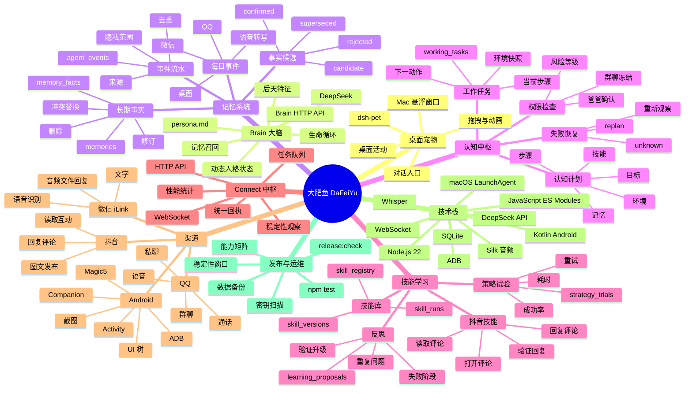

# 大肥鱼项目思维导图



## 核心逻辑

大肥鱼由桌面宠物、Brain 和 Connect 三个主要部分组成。

桌面宠物负责显示形象、接收桌面对话和展示状态动画。Brain 负责人格、记忆、模型调用和生命循环。Connect 负责微信、QQ、Android、抖音以及任务、权限、回执和稳定性管理。

## 一次桌面对话的流程

```text
爸爸输入消息
    ↓
dsh-pet
    ↓ HTTP
brain/server.mjs
    ↓
读取 persona.md
    ↓
读取动态人格状态和后天特征
    ↓
召回相关长期记忆
    ↓
读取近期生活记录
    ↓
调用 DeepSeek
    ↓
返回大肥鱼回复
    ↓
写入每日记忆、事件流水和必要的长期记忆
    ↓
桌面显示回复和活动动画
```

## 一次手机操作的流程

```text
爸爸提出目标
    ↓
Connect 创建任务
    ↓
working_tasks 保存当前状态
    ↓
环境观察
    ↓
认知中枢生成计划
    ↓
选择技能和策略
    ↓
Policy Engine 检查权限
    ↓
ADB / Companion 执行动作
    ↓
设备返回真实回执
    ↓
推进下一步骤或进入 unknown
    ↓
失败时重新观察和规划
    ↓
写入 skill_runs、strategy_trials 和 agent_events
```

## 记忆流程

```text
微信 / QQ / 桌面消息
    ↓
daily_memory_events
    ↓ 每日整理
daily_digest
    ↓
事实候选
    ↓ 爸爸确认
memory_facts
    ↓
长期记忆召回
```

普通消息只进入每日记忆。明确要求记住的内容，或者经过确认的事实，才进入长期记忆。被替代的旧事实保留历史，但不会继续参与上下文召回。

## 技术栈分工

| 层 | 技术 | 主要职责 |
|---|---|---|
| 桌面 | dsh-pet、Node.js | 悬浮形象、拖拽、动画、对话入口 |
| 大脑 | Node.js、DeepSeek API | 人格、记忆召回、对话、认知计划 |
| 数据 | SQLite、WAL | 记忆、任务、技能、事件和回执 |
| 手机 | Kotlin、WebSocket | Companion、通知、Overlay、手机状态 |
| 自动化 | ADB、UIAutomator、截图 | Magic5 观察和动作执行 |
| 通信 | 微信 iLink、QQ Bot、WebSocket | 多渠道收发消息和语音 |
| 音频 | Whisper、Silk、TTS | 语音识别、合成和传输 |
| 运维 | LaunchAgent、npm scripts | 自动启动、测试、备份、稳定性检查 |

## 当前能力边界

当前系统已经具备多渠道对话、记忆、任务、认知计划、技能统计和 Android 接入。抖音互动属于实验能力，Windows、小红书、哔哩哔哩和购物支付尚未接入。正式发布还需要完成168小时稳定性窗口。
