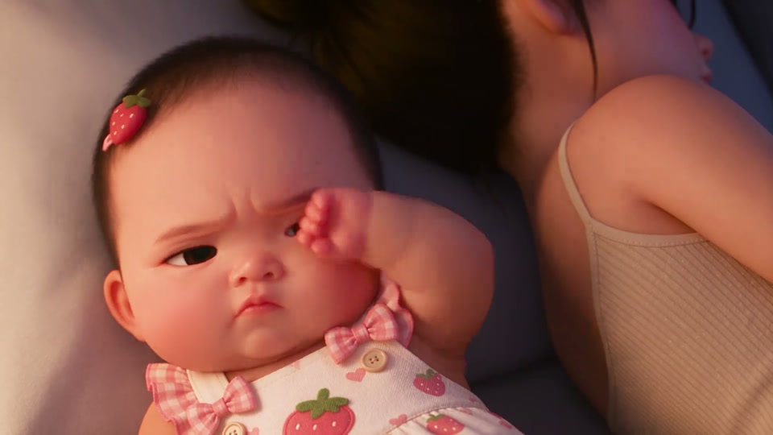
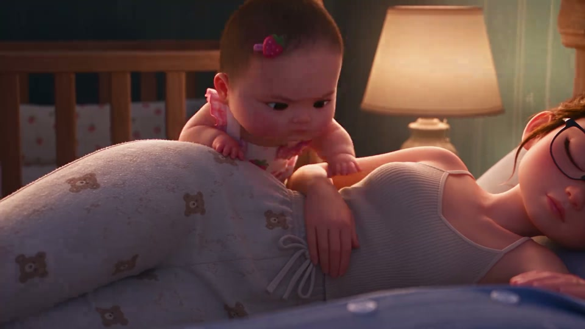
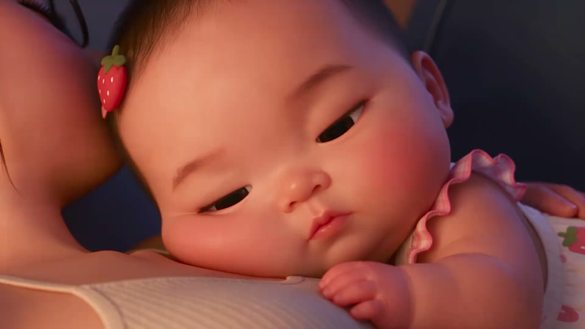

# 又又：妈妈，你拍错啦！你的宝宝在这边呢！😂

- 作者：@又来了　时长：30.7s　画面：1920×1080
- 题材：亲子日常 / 搞笑反转 / 温馨治愈
- 一句话：妈妈夜拍熟睡宝宝，镜头一转，宝宝竟在爸爸怀里。
- 在线页面：http://127.0.0.1:8800/reverse?video_id=823&run=1

## 剧情反推

这条视频用30秒完成了一个温馨又好笑的亲子小剧场。开场是夜晚卧室，冷蓝色窗外光与暖色皮肤光形成对比，戴黑框眼镜的妈妈和穿草莓图案衣服的宝宝并排躺着。宝宝先睁眼看向镜头，表情呆萌，妈妈温柔地侧头贴近，随后两人都闭眼入睡，画面安静得像一张睡前明信片。观众以为这是一段妈妈哄宝宝睡觉的日常记录。但第6秒画面突然切到妈妈和年轻男子并排熟睡，妈妈的手搭在男子肩上，关系明确：这是爸爸。此时镜头再回到宝宝的特写，宝宝闭眼熟睡，嘴巴微张，戴草莓发夹，安详稚嫩。第9秒宝宝醒来，皱眉揉眼，一副刚睡醒的烦躁模样，似乎在找什么。接着宝宝趴着伸手够向背对熟睡的妈妈，又爬到妈妈身上，低头靠近妈妈的脸，依恋又好奇。第18秒画面拉开，观众看到三人同床：妈妈、爸爸和宝宝。宝宝没有睡在妈妈身边，而是趴在爸爸胸口，抬头张望，表情清醒又好奇。最后特写宝宝微微抬眼看向镜头，慵懒困倦，呆萌可爱。整条视频没有一句台词，仅靠画面和字幕“嗯”完成叙事：妈妈本想拍身边的宝宝，结果镜头一转，宝宝其实在爸爸那边，标题“妈妈，你拍错啦！你的宝宝在这边呢”正是宝宝视角的吐槽。反转不在于情节多复杂，而在于观众和妈妈一起被“骗”了：以为宝宝在妈妈身边，其实宝宝早已换到爸爸怀里。

## 人物与场景

- **妈妈**：25-30岁女性，戴黑框眼镜，家居服（拍摄者/推进者）
- **婴儿**：穿草莓图案衣服、戴草莓发夹的宝宝（被拍摄对象/反转核心）
- **爸爸**：年轻男性，熟睡中（反转后的陪伴者）

场景：夜晚卧室，冷蓝环境光与暖黄台灯交织，床品为蓝色系，氛围安静温馨。

## 情绪曲线

0s 温馨安静 → 8s 宝宝醒来略带烦躁 → 14s 宝宝寻找妈妈的依恋 → 18s 反转揭晓的意外好笑 → 27s 宝宝呆萌抬眼，治愈收尾

## 分镜还原

| 时间 | 节拍 | 画面 | 台词 | 叙事功能 |
| --- | --- | --- | --- | --- |
| 0-6s | 温馨铺垫 | 妈妈与婴儿并排躺，婴儿睁眼后闭眼入睡，妈妈温柔注视。 | [无台词] | 建立妈妈与宝宝的亲密关系，营造睡前宁静氛围。 |
| 6-8s | 视角转移 | 画面切到妈妈与爸爸并排熟睡，妈妈手搭爸爸肩。 | [无台词] | 暗示妈妈原本的拍摄对象可能不是宝宝，为反转埋伏笔。 |
| 8-12s | 宝宝醒来 | 特写婴儿闭眼熟睡，随后醒来皱眉揉眼，显得迷糊不悦。 | [无台词] | 制造小冲突：宝宝被冷落/被拍错，情绪开始变化。 |
| 12-18s | 寻找妈妈 | 婴儿趴着伸手够向熟睡妈妈，又趴在妈妈身上靠近脸部。 | [无台词] | 强化宝宝对妈妈的依恋，同时为最终反转做情感铺垫。 |
| 18-28s | 反转落点 | 全景显示妈妈、爸爸和婴儿同床，婴儿趴在爸爸胸口抬头张望，最后特写婴儿慵懒抬眼。 | [无台词] | 揭示宝宝实际在爸爸怀里，完成“拍错啦”的幽默反转，落点在宝宝呆萌表情。 |

## 画面感最强的 4 帧

打分方式：VLM 画面张力 65% + 本地画质 35%；时间间隔约束保证 4 帧来自不同时刻。

### 01 · t=9.9s · 71 分

特写，卧室床上，夜晚，暖色灯光，戴草莓发夹的婴儿醒来，皱眉，小手揉眼，迷糊、不悦、刚醒的烦躁

构图：婴儿面部居中偏左，小手举至眼前，右侧女子肩颈作背景　光线：暖光侧照，面部立体，背景虚化

### 02 · t=0.5s · 70 分

近景，夜晚卧室，蓝色冷光从窗外透入，室内暖光微弱，氛围安静，戴黑框眼镜的年轻女性和穿草莓图案衣服的婴儿两人并排躺着，婴儿睁眼看向镜头，女性侧头贴近婴儿，婴儿表情略显呆萌、微皱眉；女性神情温柔疲惫

构图：婴儿位于前景左下，女性位于右后方，形成对角线构图，枕头和床品作为背景　光线：侧逆光，冷蓝色环境光与暖色皮肤光对比，浅景深突出面部

### 03 · t=15.2s · 66 分

中景，卧室床上，夜晚，暖色台灯照明，婴儿与熟睡的母亲，婴儿趴在母亲身上，抬头看向母亲，婴儿好奇、专注

构图：婴儿位于画面上方中心，母亲横卧下方，台灯在背景右侧形成光源　光线：暖黄色台灯光，柔和，中景深

### 04 · t=27.6s · 59 分

特写，卧室床上，夜晚，近距离睡眠氛围，婴儿的脸部，婴儿趴在大人身上，微微抬眼看向镜头方向，慵懒、困倦、略带呆萌

构图：婴儿面部占据画面主体，草莓发夹为点缀，前景手臂形成框架　光线：暖调柔光，面部高光柔和，背景虚化

---

由「灵感浮生 · 画面反推」自动生成：解析直链 → 下载 → 抽帧 → Whisper 字幕 → VLM 逐帧读画面 → 剧情缝合。
